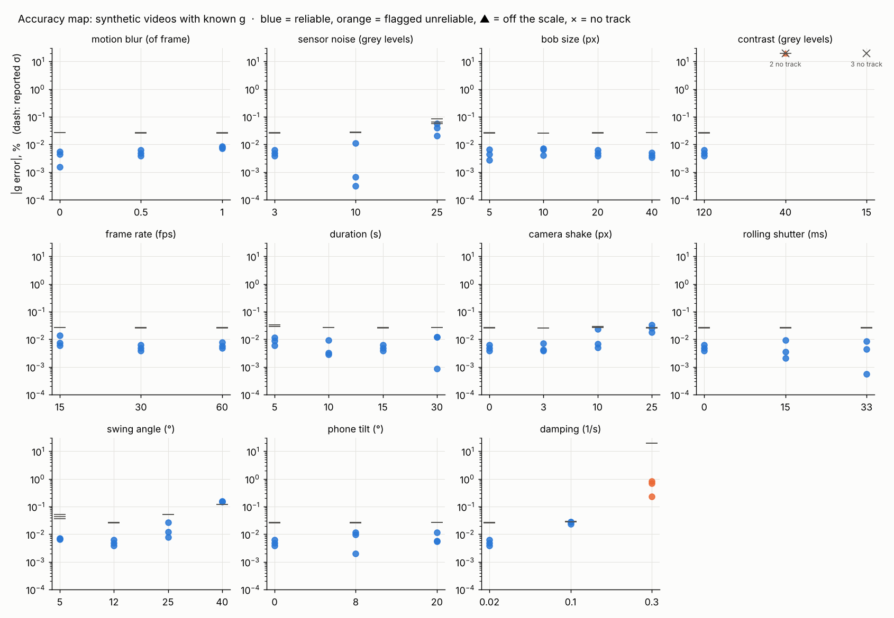

# Galileo — your phone is the lab, the AI runs the experiment

[](https://github.com/Giochvanno/hackathon-meta-galileo/actions/workflows/ci.yml)

Film a simple experiment with a phone. Galileo measures the motion frame by frame with
**SAM 3.1** (Meta Model API), fits competing physical models with honest uncertainties,
and lets a **Muse Spark** agent run the scientific loop: choose the model the data supports,
estimate g, register a falsifiable prediction for the next experiment, and verify it
against a new recording.

> Built for the Meta Global AI Developer Hackathon (Indie track), Oct 30 – Nov 4, 2026.

## Results at a glance

Real experiments, filmed on a phone (golf ball on a sewing thread, AA battery on a cable),
tracked by SAM 3.1, analysed by the code in this repository, judged by the Muse Spark agent.

| | Value | Reference |
|---|---|---|
| **g from four lengths** (T0² vs L, with a length-offset term) | **9.821 ± 0.126 m/s²** | 9.7975 m/s² for Busan (+0.24 %, 0.2 σ) |
| **Blind predictions, pendulum** | **2 confirmed, 1 in tension** (z = 0.76, 0.73, −2.17) | P4 is registered and waiting |
| **Blind prediction, bouncing ball** | **B1 failed** on 2 of 3 drops | the instrument found why: hand releases from 31–34 cm, not 30 |
| Period precision from one 34 s video | ± 0.0002 s (0.02 %) | |
| SAM 3.1 vs a model-free OpenCV tracker on the same video | periods agree to 0.05 % | |
| Fully automatic run (Muse Spark finds the ball, SAM 3.1 tracks it) | T0 = 1.3982 s, **identical to a human click** | |
| Cost | ≈ $0.20 per video (SAM), ≈ $0.02 to look (Spark), ≈ $0.035–0.05 per agent run | |
| Tests | 60, run in CI on every push | |

Every number below can be checked: the notebook, the agent logs, the tracks and the fits of
each run are in [`docs/evidence`](docs/evidence/README.md).

### The experiments

| ID | Setup | Length L (pivot → bob centre) | Small-angle period T0 | g from this run alone |
|---|---|---|---|---|
| E1 | AA battery tied to a USB cable, length by eye | 0.390 ± 0.010 m | 1.2460 ± 0.0005 s | 9.92 ± 0.25 |
| E2 | golf ball on sewing thread, tape-measured | 0.619 ± 0.003 m | 1.5852 ± 0.0008 s | 9.725 ± 0.048 |
| E3 | golf ball on thread, released at ~19°, 31 full swings | 0.289 ± 0.003 m | 1.0868 ± 0.0002 s | 9.650 ± 0.100 |
| E4 | golf ball on thread, ~7°, 23 full swings, white ball in front of a white panel | 0.489 ± 0.003 m | 1.3982 ± 0.0003 s | 9.875 ± 0.061 |

Damping: the AIC comparison prefers quadratic air drag for the golf ball (E3: the runner-up,
viscous damping, is 145 AIC units behind) and viscous damping for the battery on a stiff cable,
a different physical system.

### The predictions (pre-registered by the agent, tested blind)

Each prediction was made by the agent and frozen in the lab notebook *before* the
experiment that tests it was filmed. The frozen model is re-evaluated at the length actually
cut (a thread is never cut exactly to plan).

| | Made from | Planned | Tested by | Predicted T0 at the real length | Measured T0 | z | Verdict |
|---|---|---|---|---|---|---|---|
| P1 | E1 only (g = 9.92 ± 0.25) | 0.600 m | E2 (0.619 m) | 1.5697 ± 0.0205 s | 1.5852 ± 0.0008 s | +0.76 | **confirmed, blind** |
| P2 | E1 + E2 (g = 9.731 ± 0.047) | 0.300 m | E3 (0.289 m) | 1.0822 ± 0.0062 s | 1.0868 ± 0.0002 s | +0.73 | **confirmed, blind** |
| P3 | E1 + E2 + E3 (with length offset) | 0.500 m | E4 (0.489 m) | 1.4097 ± 0.0053 s | 1.3982 ± 0.0003 s | −2.17 | **tension** |
| P4 | E1 – E4 (with length offset) | 0.700 m | — | 1.6806 ± 0.0055 s | — | — | pending |

The agent found each test on its own: it noticed that the new experiment was added after the
pending prediction and that its length was within the allowed 20 % of the plan, verified it,
refitted g with the new length, and registered the next prediction (8 turns, $0.035–0.05).

**P3 is in tension (z = −2.2), and the data say why.** The period of every run is known to
0.02 %; the length is not. With the local g, the measured periods imply lengths of 623.6,
293.1 and 485.1 mm for E2–E4, against 619.0, 288.7 and 489.0 mm on the tape: differences of
+4.6, +4.4 and −3.9 mm, while each length was entered as ± 3 mm. The four-length fit agrees
(χ² = 5.5 for 2 degrees of freedom, larger than expected). Where exactly the thread leaves the
tape, and where the centre of the ball is, is uncertain by about 4–5 mm when the setup is
rebuilt for every length; ± 3 mm was optimistic. The agent read it the same way: "record the
0.70 m experiment to decide if the P3 tension is noise or bias in length scale."

## How the measurement works

`video → SAM 3.1 masks → centroid track → period → g ± σ`

* **SAM 3.1** segments and tracks the pendulum bob from a noun phrase ("white earbud"),
  or from a single click / box when the phrase is ambiguous.
* **Exact frame timestamps.** Android records variable frame rate; we read each frame's
  real presentation time instead of assuming `i / fps`.
* **Camera-shake compensation.** Static scene features are tracked frame to frame
  (Lucas-Kanade + RANSAC) and every position is mapped back to frame 0, so a phone
  leaning on a book or held by hand still measures correctly.
* **Four damping laws compared by AIC:** none, viscous (∝v), quadratic air drag (∝v²),
  Coulomb pivot friction — the measurement decides, not us.
* **Two independent period estimates:** a nonlinear model fit and a model-free
  zero-crossing regression; their agreement is reported in σ.
* **Honest error bars:** least-squares errors inflated for frame-to-frame correlated
  tracking error (AR(1) correction), length error propagated.
* **Finite-amplitude correction:** the bob moves on an arc, so a geometric circle fit gives
  the pivot, the swing angle and a pixel→metre scale for free.
* **Reference g from latitude** (WGS84 normal gravity), not a hard-coded 9.81.

On a synthetic video with known physics (13°, damped, motion blur, a decoy object):
`g = 9.797 ± 0.038 m/s²` vs true `9.7975`.

**First real measurement** (phone video, AA battery on a cable, SAM 3.1 point prompt):
`g = 9.92 ± 0.25 m/s²` vs local `9.7975` (+1.2 %, 0.5 σ). The uncertainty is almost all
from the length, measured by eye; the period itself is known to 0.04 %.


## The experimenter agent

Muse Spark drives the lab through seven tools, each a tested Python function on a JSON lab
notebook (`runs/lab.json`):

| Tool | What it does |
|---|---|
| `list_experiments` | experiments, predictions and the current model |
| `analyze_experiment` | period by two methods, amplitude, damping, T0, reliability problems |
| `compare_damping_models` | four damping laws, ΔAIC and Akaike weights |
| `estimate_g` | weighted fit of T0² against L (with a length offset once there are 3+ lengths) |
| `predict_period` | registers a frozen, falsifiable prediction for a new length |
| `verify_prediction` | z-score and verdict; marks whether the test was blind |
| `request_experiment` | asks the human for the next recording |

Design rules that keep it honest:

* **The model does no arithmetic.** Every number it reports comes from a tool result.
* **The textbook g is hidden from the model,** so its estimate cannot drift toward it.
* **Pre-registration.** A prediction copies the model it was made from. It only counts as a
  blind test if the experiment was added to the notebook after it, and was not used to
  build the model.
* **Errors are data.** A failing tool returns the error to the model, which can correct itself.
* Every run writes a step-by-step JSONL log with tokens and cost.

```bash
python -m galileo.cli lab add runs/my_pendulum/track.csv --length 0.39 --length-err 0.003 --t-start 5
python -m galileo.cli agent            # the agent measures, decides, predicts, asks for an experiment
# ...record the experiment it asked for, run `pendulum` on it, `lab add` it, then:
python -m galileo.cli agent            # the agent verifies its own prediction
python -m galileo.cli lab show
```

Muse Wonder is not available to this account (the API returns 404; the organizers confirmed
it is outside the hackathon credits and not required), so the agent runs on `muse-spark-1.3`.
Set `MODEL_AGENT=muse-wonder-1.0` in `.env` wherever it is available.

## The lab assistant: no clicking (Muse Spark sees, SAM 3.1 tracks)

`look` shows Muse Spark ten frames of the video (dense at the start, where the release is).
It answers in structured JSON: what kind of experiment this is, which object to measure, the
earliest frame where it is free of the hand, where it is (on Spark's 0–1000 grounding grid),
where the pivot or the floor is, and what is wrong with the setup. The point is then snapped to
the centre of the moving object next to it (the thickest region that differs from the
video's median background) and handed to SAM 3.1 as the prompt. `--auto` does all of it:

```bash
python -m galileo.cli look     my_pendulum.mp4             # what Spark sees: look.png + notes
python -m galileo.cli pendulum my_pendulum.mp4 --auto --length 0.489
```

On E4 (white ball in front of a white panel) Spark picked frame 30 (a person picked frame 28),
noted the low contrast, the faint string and the hidden pivot, and the fully automatic run gave
**T0 = 1.3982 ± 0.0003 s, the same as with a human click** (≈ $0.02 for Spark, $0.20 for SAM).

The first automatic run failed, safely: Spark pointed 54 px above the ball, onto the shelf
edge; SAM tracked the shelf, and the pipeline refused the motionless object instead of
reporting a g. Snapping to the thickest moving region fixed it (thin strips such as an edge,
the string or fingers lose), with a limit of two object radii so that a hand still holding the
ball is not taken for it.

## Second system: a bouncing ball (coefficient of restitution)

The same pipeline measures a different experiment. Drop a ball on a hard floor and film it:

`video → SAM 3.1 masks → height track → one parabola per flight → impact times → e ± σ`

* **Only time, no ruler.** A free flight that starts at speed v lasts 2v/g, so the
  coefficient of restitution is a ratio of flight times: e = T(n+1) / T(n).
* **Impacts between frames.** An impact is where two neighbouring flight parabolas meet,
  so it is timed far better than the frame spacing (≈0.3 ms at 30 fps on synthetic drops,
  where frames are 33 ms apart), with an error from the parabola covariances.
* **Two models compared by AIC:** constant e, and e that changes with impact speed.
  The fit uses the impact times themselves (independent errors), not averaged ratios.
* **Guards:** every flight must show the same curvature (same gravity, same scale);
  periodic motion with no energy loss (e ≈ 1) is refused as "not a bouncing ball".
* **Predictions:** later impacts from the first few, and the first flight after a drop
  from a new height (to be tested on a new recording).
* With `--drop-height`, the pixel scale gives an independent rough g as a cross-check.

* **Rolling shutter is measured and removed.** A phone sensor reads rows one after another,
  so a fast ball lower in the image is seen later. The delay per row is fitted from the
  flights themselves (the value that makes them the best parabolas).

**First real drop** (golf ball on a laminate floor, phone on the floor, 30 fps, SAM 3.1 point
prompt one frame after the release):

| | Value |
|---|---|
| impacts timed | 8 (errors 0.4–2.6 ms; frames are 34 ms apart) |
| **coefficient of restitution** | **e = 0.8638 ± 0.0004**, the same at every impact within errors (constant-e model preferred, ΔAIC 0.7: not decisive) |
| e at single impacts, 2.7 → 1.3 m/s | 0.866, 0.864, 0.861, 0.869, 0.855, 0.870 |
| rolling shutter found in the data | 33 µs per row = 24 ms per frame, typical for phone sensors; tracking residuals 5× smaller after the correction |
| cross-check: OpenCV tracker on the same video | e = 0.863 ± 0.003 |

**Pre-registered prediction B1** (made from this drop and committed at 15:17 KST, before the
next video was filmed): a drop from **30 cm** (floor to the bottom of the ball) gives a first
flight of **0.4275 ± 0.0036 s**.

**The test: three drops "from 30 cm", released by hand** (one video, SAM 3.1, analysed blind
against B1):

| Drop | First flight measured | vs B1 | Verdict | How far the ball really fell, from timing / from pixels | e of this drop |
|---|---|---|---|---|---|
| 1 | 0.4241 ± 0.0025 s | z = −0.8 | confirmed | 31.2 ± 0.4 cm / release not in the track | 0.841 ± 0.002 |
| 2 | 0.4386 ± 0.0011 s | z = +2.9 | tension | 31.2 ± 0.2 cm / 31.3 cm | 0.869 ± 0.002 |
| 3 | 0.4558 ± 0.0009 s | z = +7.6 | **refuted** | 34.1 ± 0.3 cm / 33.6 cm | 0.864 ± 0.003 |

**B1 failed as registered: one drop of three agrees.** The instrument shows why, and in two
independent ways. It measures how far the ball fell from the flight time (g T² / 8e²) and from
the pixels (release-to-impact distance, with the pixel scale taken from the curvature of the
flight); the two agree within 0.5 cm, and both say the hand released the ball from 31–34 cm,
not 30. The coefficient of restitution itself also differs from drop to drop (0.841–0.869,
probably where and with what spin the ball hits the laminate). Drop 1 "agreed" partly by
luck: it fell 31 cm but bounced lower.

A check that is *not* blind, done after the verdict: re-evaluating B1's frozen e (0.8638) at the
height measured from the pixels (which does not use the flight time) gives 0.4367 s for drop 2
(measured 0.4386 s, +0.4 %) and 0.4524 s for drop 3 (measured 0.4558 s, +0.8 %).

The physics held; the prediction's error bar did not. It counted ±5 mm of drop height and the
fit error of e, while a hand release varies by centimetres and e varies by ±1.5 % between
drops. The honest error bar for "drop it from 30 cm by hand" is about ±0.016 s (±2 cm of height
and ±1.5 % in e), not ±0.004 s.
Next test: a fixed release point and several drops, so the spread is measured, not assumed.

```bash
python -m galileo.cli bounce my_drop.mp4 --point 610,240 --prompt-frame 20 \
    --drop-height 0.50 --predict-height 0.30
python scripts/make_synthetic_bounce.py --e 0.8 --drop 0.5    # known answer, for testing
```

## Validation and lessons learned

What we checked, what went wrong on the way, and what we changed because of it.

**Checks with a known answer**
* Synthetic pendulum video (13°, damped, motion blur, a decoy object): g = 9.797 ± 0.038 vs
  9.7975 true.
* Synthetic bouncing-ball drops: impacts timed to ≈0.3 ms at 30 fps; e = 0.8001 ± 0.0001
  vs 0.800; no false alarms in 270 simulated drops (30/60/120 fps, three restitution laws,
  two noise levels); the error bars are calibrated (pull spread ≈ 1 over 200 drops).
* Two independent trackers on the same real video (SAM 3.1 and OpenCV background
  subtraction): T0 = 1.0868 vs 1.0862 s.
* Two independent period estimates on every run (model fit and zero-crossing regression):
  0.2–0.6 σ apart on all three real experiments.

**Accuracy map: where the instrument works and where it breaks.** `scripts/accuracy_map.py`
renders 81 synthetic pendulum videos with a known g (`galileo/synth.py`: exact nonlinear motion,
per-row exposure for shutter blur and rolling shutter), changes one condition at a time, and runs
the normal pipeline on each. With the model-free OpenCV tracker
([full table](docs/accuracy_opencv.md)):

* **Robust:** motion blur up to a full frame, 5–40 px bobs, 15–60 fps, 5–30 s recordings, rolling
  shutter up to 33 ms, a phone rolled by 20°, camera shake up to 25 px: g within **0.03 %**.
* **Degrades:** sensor noise σ = 25 grey levels (0.04 %); a 40° swing (0.15 %: keep it under 25°).
* **Refuses rather than lies:** strong damping (amplitude gone in a few seconds) is flagged
  UNRELIABLE 3/3 with a huge error bar; a low-contrast bob (40 or 15 grey levels above the
  background) is lost by the model-free tracker, and the one track it produced was flagged.
  This is where SAM 3.1 has to earn its place: the same map with SAM is the next run.
* **Error bars are conservative:** the reported σ is about 5× the actual scatter in the easy
  cases (the period error is the larger of two independent estimates), and grows when the
  conditions get hard.



**Things that went wrong, and the fix**
* *SAM text prompt matched the wrong object.* "battery" segmented a soda can on the desk;
  the motionless can gave g = 0.30. → The pipeline now refuses objects that do not move,
  flags low signal-to-noise and irregular timing as UNRELIABLE, and supports a one-click
  point prompt on a chosen frame.
* *A hand in the first seconds.* It moved the "static" background and the camera-motion
  estimate drifted by 46 px. → Stabilization is re-referenced to a frame after the release.
* *Camera not square to the swing.* The arc looks tilted, so the circle fit puts the pivot
  in the wrong place and misjudges the swing angle. → `--amplitude-deg` overrides it; the
  overlay draws the pivot only when the arc fit is trusted.
* *The agent did not test P1.* The thread was cut to 0.619 m, not 0.600 m, and the agent
  treated that as a different experiment. → `verify_prediction` re-evaluates the frozen model
  at the real length and accepts tests within 20 % of the plan.
* *Server-side conversation state expired* (`previous_response_id` not found). → The agent
  keeps the whole history itself (`store=false`) and replays encrypted reasoning.
* *No tool call with a small output limit.* Reasoning tokens used up `max_output_tokens=300`
  before the model reached the tool call. → 16 000.
* *Overclaiming.* The agent once wrote that a damping law was "proven". → AIC only ranks
  models; the prompt now asks for "strongly preferred / preferred / not decisive".
* *The first real ball drop was flagged UNRELIABLE.* The two biggest flights were not clean
  parabolas: residuals of 5–6 px in a W pattern. The cause was the phone's rolling shutter
  (the ball crosses 400 rows in a flight, and lower rows are read up to 24 ms later). → Each
  point now gets the time of its own row; the delay is fitted from the data, and the
  correction is applied only when it clearly improves the fit (never on synthetic data
  without the effect). Flight times did not change, because all impacts happen on the same
  row; the impact estimates and error bars did.
* *A hand at the edge of the frame* was the biggest moving object for the model-free
  tracker. → `--roi` limits where it looks (SAM follows the clicked object anyway).
* *A nonsense number: "e changes by −2403 per second".* A local variable for the pixel
  velocity overwrote the restitution slope in one code path. → Renamed, regression test added;
  the speed-dependent model now needs 6 impacts (it had 1 degree of freedom with 5).
* *The release was at the top edge of the frame and blurred.* → The first flight can also be
  timed from where its parabola leaves the floor level, and a recording that starts in the
  middle of the bounces is never mistaken for the drop.

**Blinding the length.** For E3 the measured length was first reported as "31 cm". Whether
that meant the bottom or the centre of the ball decides the verdict: the two readings differ
by 2.1 cm, which is several times the prediction's uncertainty. The measuring protocol
(from where the thread leaves the tape, to the bottom of the ball) was fixed *before* the
verdict was computed or shown, so the length could not be chosen to fit the prediction.

## Known limits

* **The length dominates the error.** A 3 mm tape-measure error on a 29 cm thread is 1 % in
  g; the period is known 50 times better. The length-offset fit absorbs a constant error in
  where the bob's centre is, at the price of a larger uncertainty with only three lengths.
* The swing angle comes from the arc only when the camera faces the swing squarely.
* A release with a small sideways push makes the bob swing on an ellipse that slowly
  rotates; the amplitude seen by the camera then rises and falls. The period estimates still
  agreed on E3, but a clean release is better.
* E1 (battery on a stiff cable, length by eye) is not an ideal pendulum; it is kept because
  the fit weighs it accordingly (its error bar is 2.5–5 times larger than the others).
* Bouncing ball: air drag is not modelled (≈0.4 % of gravity for a golf ball at 3 m/s). The
  ball drifts sideways and in depth after a few bounces, so the flights' curvature in pixels
  changes; e uses only times and is not affected, but the pixel scale (and the rough g from
  `--drop-height`) is. The first drop height was set by eye (±2 cm).
* The agent cannot see the video; it only sees tool results.

## Setup

```bash
python -m venv .venv && source .venv/bin/activate      # Windows: .venv\Scripts\activate
pip install -e ".[dev]"
cp .env.example .env                                    # put your MODEL_API_KEY in it
pytest -q                                               # 60 tests, no network needed
```

ffmpeg comes with `imageio-ffmpeg`; no system install needed.

## Run

```bash
# 1. ~$0.01: which phrase finds exactly one bob? Writes probe_*.png with boxes.
python -m galileo.cli probe my_pendulum.mp4 --prompts earbud "white earbud" earphone

# 2. ~$0.12 for 20 s at 30 fps. The raw SAM output is cached in runs/<name>/.
python -m galileo.cli pendulum my_pendulum.mp4 --length 0.52 --prompt "white earbud" --t-start 1.5

#    phrase not working? click the bob on frame 0 instead (coordinates in runs/<name>/video.mp4)
python -m galileo.cli pendulum my_pendulum.mp4 --length 0.52 --point 655,402

# 3. free: re-fit an existing track with other settings
python -m galileo.cli analyze runs/my_pendulum/track.csv --length 0.52 --t-start 3

# no API at all: background-subtraction tracker, to cross-check SAM
python -m galileo.cli pendulum my_pendulum.mp4 --length 0.52 --tracker opencv --out runs/check_cv
```

Outputs in `runs/<name>/`: `report.png`, `overlay.png`, `result.json`, `track.csv`,
`sam_<prompt>.txt` (raw SAM output).

## Recording tips that matter

* Phone **fixed** (books, tripod). Turn **video stabilisation off**: it warps frames and
  fakes motion.
* Pivot **in frame**, swing **across** the frame, bob against a plain contrasting background.
* Bright light (short shutter → less blur). 1080p, 30 or 60 fps.
* L = pivot to the **centre of the bob**, with a tape measure. Swing 10–15°, 20+ s.

## Layout

```
galileo/
  video.py       ffmpeg preprocessing, exact per-frame timestamps
  sam_client.py  SAM 3.1 via Responses API: upload, stream, text/point/box prompts
  sam_track.py   SAM wire output -> mask centroids -> per-object tracks
  cv_track.py    model-free fallback tracker (median background subtraction)
  pendulum.py    model fits, AIC, zero crossings, arc fit, corrections, g, predictions
  bounce.py      bouncing ball: flight parabolas, impact times, restitution models, predictions
  stabilize.py   camera-motion compensation
  lab.py         lab notebook: experiments, T0²-vs-L fit, frozen predictions, blind verification
  agent.py       Muse Spark tool loop, tools, run logs with token cost
  assistant.py   Muse Spark looks at the video: object, release frame, pivot/floor, setup issues
  synth.py       synthetic pendulum videos with known g and controlled degradations
  report.py      report.png, overlay.png, bounce_report.png
  render.py      overlay video: SAM mask, trail and live numbers on every frame
  cli.py         probe / pendulum / bounce / analyze / render / lab / agent
scripts/make_synthetic_pendulum.py   video with known g for end-to-end tests
scripts/make_synthetic_bounce.py     bouncing-ball video with known e
scripts/accuracy_map.py              81 synthetic videos, one condition changed at a time
scripts/check_models.py              which models this key can use, and whether they call tools
tests/                               physics, SAM parsing, lab, agent loop and API client against fake servers
```

## Built during the hackathon

All code in this repository was written during the hackathon, after the official kickoff:
the first commit is dated Oct 30, 2026, and the commit history shows every step since.

| Day | What happened |
|---|---|
| Oct 30 | SAM 3.1 pipeline, physics fits, synthetic validation; first real run (battery, g = 9.92 ± 0.25) |
| Oct 31 | Muse Spark agent with 7 tools and a lab notebook; golf-ball pendulum E2; **P1 confirmed blind**; overlay video; CI |
| Nov 1 | E3 filmed; **the agent verified P2 blind by itself**; Muse Spark lab assistant (fully automatic run = human click); E4: P3 in tension (z = −2.2, traced to ±4–5 mm length errors); g from three lengths 9.782 ± 0.127; bouncing-ball module; first real drop e = 0.8638 ± 0.0004 with rolling-shutter correction; prediction B1 registered and **failed on 2 of 3 drops** (hand release 31–34 cm, measured from the video) |