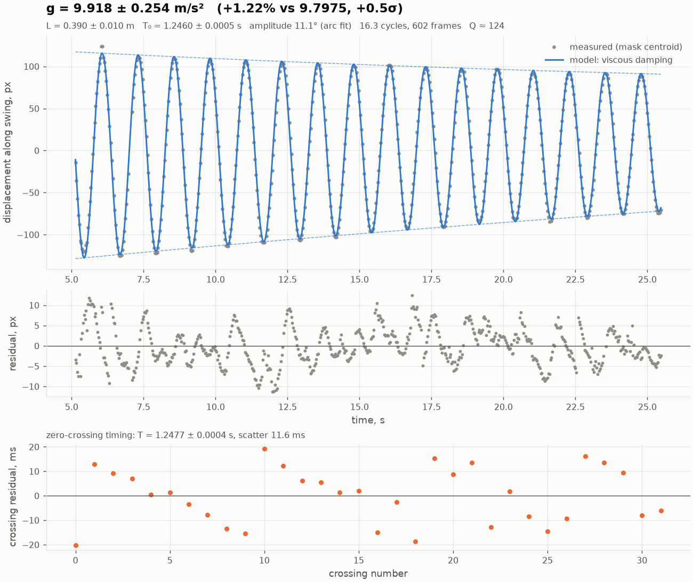

# Galileo — your phone is the lab, the AI runs the experiment

Film a simple experiment with a phone. Galileo measures the motion frame by frame with
**SAM 3.1** (Meta Model API), fits competing physical models with honest uncertainties,
and lets a **Muse Spark** agent run the scientific loop: choose the model the data supports,
estimate g, register a falsifiable prediction for the next experiment, and verify it
against a new recording.

> Built for the Meta Global AI Developer Hackathon (Indie track), Oct 30 – Nov 4, 2026.

## What works today (day 1)

`video → SAM 3.1 masks → centroid track → period → g ± σ`

* **SAM 3.1** segments and tracks the pendulum bob from a noun phrase ("white earbud"),
  or from a single click / box when the phrase is ambiguous.
* **Exact frame timestamps.** Android records variable frame rate; we read each frame's
  real presentation time instead of assuming `i / fps`.
* **Camera-shake compensation.** Static scene features are tracked frame to frame
  (Lucas-Kanade + RANSAC) and every position is mapped back to frame 0, so a phone
  leaning on a book or held by hand still measures correctly.
* **Four damping laws compared by AIC:** none, viscous (∝v), quadratic air drag (∝v²),
  Coulomb pivot friction — the measurement decides, not us.
* **Two independent period estimates:** a nonlinear model fit and a model-free
  zero-crossing regression; their agreement is reported in σ.
* **Honest error bars:** least-squares errors inflated for frame-to-frame correlated
  tracking error (AR(1) correction), length error propagated.
* **Finite-amplitude correction:** the bob moves on an arc, so a geometric circle fit gives
  the pivot, the swing angle and a pixel→metre scale for free.
* **Reference g from latitude** (WGS84 normal gravity), not a hard-coded 9.81.

On a synthetic video with known physics (13°, damped, motion blur, a decoy object):
`g = 9.797 ± 0.038 m/s²` vs true `9.7975`.

**First real measurement** (phone video, AA battery on a cable, SAM 3.1 point prompt):
`g = 9.92 ± 0.25 m/s²` vs local `9.7975` (+1.2 %, 0.5 σ). The uncertainty is almost all
from the length, measured by eye; the period itself is known to 0.04 %.



## The experimenter agent (day 2)

Muse Spark drives the lab through seven tools, each a tested Python function on a JSON lab
notebook (`runs/lab.json`):

| Tool | What it does |
|---|---|
| `list_experiments` | experiments, predictions and the current model |
| `analyze_experiment` | period by two methods, amplitude, damping, T0, reliability problems |
| `compare_damping_models` | four damping laws, ΔAIC and Akaike weights |
| `estimate_g` | weighted fit of T0² against L (with a length offset once there are 3+ lengths) |
| `predict_period` | registers a frozen, falsifiable prediction for a new length |
| `verify_prediction` | z-score and verdict; marks whether the test was blind |
| `request_experiment` | asks the human for the next recording |

Design rules that keep it honest:

* **The model does no arithmetic.** Every number it reports comes from a tool result.
* **The textbook g is hidden from the model,** so its estimate cannot drift toward it.
* **Pre-registration.** A prediction copies the model it was made from. It only counts as a
  blind test if the experiment was added to the notebook after it, and was not used to
  build the model.
* **Errors are data.** A failing tool returns the error to the model, which can correct itself.
* Every run writes a step-by-step JSONL log with tokens and cost.

```bash
python -m galileo.cli lab add runs/my_pendulum/track.csv --length 0.39 --length-err 0.003 --t-start 5
python -m galileo.cli agent            # the agent measures, decides, predicts, asks for an experiment
# ...record the experiment it asked for, run `pendulum` on it, `lab add` it, then:
python -m galileo.cli agent            # the agent verifies its own prediction
python -m galileo.cli lab show
```

Muse Wonder is not available to this account (the API returns 404; the organizers confirmed
it is outside the hackathon credits and not required), so the agent runs on `muse-spark-1.3`.
Set `MODEL_AGENT=muse-wonder-1.0` in `.env` wherever it is available.

## Setup

```bash
python -m venv .venv && source .venv/bin/activate      # Windows: .venv\Scripts\activate
pip install -e ".[dev]"
cp .env.example .env                                    # put your MODEL_API_KEY in it
pytest -q                                               # 30 tests, no network needed
```

ffmpeg comes with `imageio-ffmpeg`; no system install needed.

## Run

```bash
# 1. ~$0.01: which phrase finds exactly one bob? Writes probe_*.png with boxes.
python -m galileo.cli probe my_pendulum.mp4 --prompts earbud "white earbud" earphone

# 2. ~$0.12 for 20 s at 30 fps. The raw SAM output is cached in runs/<name>/.
python -m galileo.cli pendulum my_pendulum.mp4 --length 0.52 --prompt "white earbud" --t-start 1.5

#    phrase not working? click the bob on frame 0 instead (coordinates in runs/<name>/video.mp4)
python -m galileo.cli pendulum my_pendulum.mp4 --length 0.52 --point 655,402

# 3. free: re-fit an existing track with other settings
python -m galileo.cli analyze runs/my_pendulum/track.csv --length 0.52 --t-start 3

# no API at all: background-subtraction tracker, to cross-check SAM
python -m galileo.cli pendulum my_pendulum.mp4 --length 0.52 --tracker opencv --out runs/check_cv
```

Outputs in `runs/<name>/`: `report.png`, `overlay.png`, `result.json`, `track.csv`,
`sam_<prompt>.txt` (raw SAM output).

## Recording tips that matter

* Phone **fixed** (books, tripod). Turn **video stabilisation off**: it warps frames and
  fakes motion.
* Pivot **in frame**, swing **across** the frame, bob against a plain contrasting background.
* Bright light (short shutter → less blur). 1080p, 30 or 60 fps.
* L = pivot to the **centre of the bob**, with a tape measure. Swing 10–15°, 20+ s.

## Layout

```
galileo/
  video.py       ffmpeg preprocessing, exact per-frame timestamps
  sam_client.py  SAM 3.1 via Responses API: upload, stream, text/point/box prompts
  sam_track.py   SAM wire output -> mask centroids -> per-object tracks
  cv_track.py    model-free fallback tracker (median background subtraction)
  pendulum.py    model fits, AIC, zero crossings, arc fit, corrections, g, predictions
  stabilize.py   camera-motion compensation
  lab.py         lab notebook: experiments, T0²-vs-L fit, frozen predictions, blind verification
  agent.py       Muse Spark tool loop, tools, run logs with token cost
  report.py      report.png and overlay.png
  cli.py         probe / pendulum / analyze
scripts/make_synthetic_pendulum.py   video with known g for end-to-end tests
scripts/check_models.py              which models this key can use, and whether they call tools
tests/                               physics, SAM parsing, lab, agent loop and API client against fake servers
```

## Built during the hackathon

All code in this repository was written during the hackathon window (Oct 30 – Nov 4, 2026).